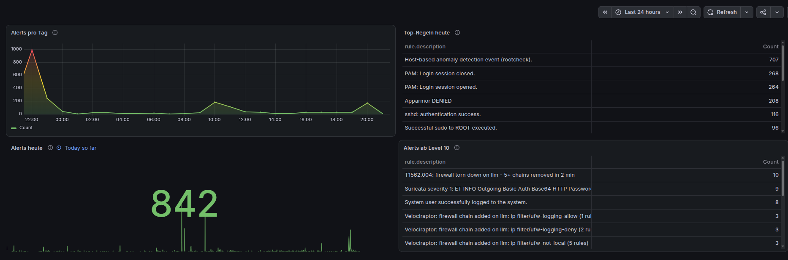
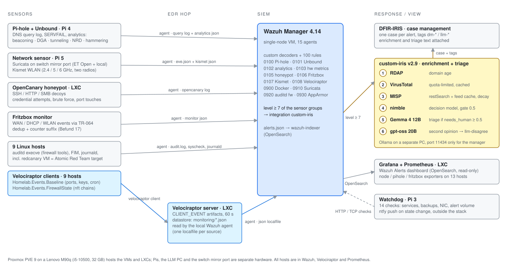

# Homelab SOC — detection engineering on a mini PC

A small security operations stack built to learn detection engineering by
doing it: six kinds of sensors feed a Wazuh SIEM, alerts are enriched with
threat intelligence and triaged by local LLMs into a DFIR-IRIS case, and every
detection was tested against the real attack technique, not just against the
rule. Everything runs on one Lenovo M90q, three Raspberry Pis and a desktop
with a consumer GPU. It has been in daily operation since September 2026, and
every mistake along the way is written down in [TUNING.md](TUNING.md).

<!-- docs/dashboard.png: Grafana "Wazuh Alerts", 24 h view, browser chrome cropped -->


## Architecture

<picture>
  <source media="(prefers-color-scheme: dark)" srcset="docs/architecture-dark.svg">
  
</picture>

| Component | Role | Runs on |
|---|---|---|
| Wazuh 4.14 | SIEM: decoders, ~100 custom rules, 15 agents, indexer | VM |
| Pi-hole 6 + Unbound | recursive DNS with blocklists; query log is the DNS sensor | Raspberry Pi 4 |
| Suricata 8 + Kismet | IDS on a switch mirror port; WLAN monitoring on two radios | Raspberry Pi 5 |
| OpenCanary | honeypot with SSH/HTTP/SMB/Redis/VNC decoys | LXC |
| Velociraptor 0.77 | EDR: baseline and firewall-state artifacts on all Linux hosts | LXC + 9 clients |
| auditd | execve auditing of firewall tools on the attack target | redcanary VM |
| DFIR-IRIS 2.4 | case management; one case per alert of level ≥ 7 | VM |
| MISP 2.5 | threat intelligence, queried with decay scoring | VM |
| Ollama | nimble (decision model), Gemma 4 12B (triage), gpt-oss 20B (second opinion) | separate PC, RX 5700 XT |
| Grafana + Prometheus | alert dashboard on the OpenSearch index; host, Pi-hole and Fritzbox metrics | LXC |
| Watchdog | 14 liveness checks with ntfy push, independent of the stack | Raspberry Pi 3 |
| Proxmox PVE 9 | hypervisor for the VMs and LXCs; nightly backups to SSD, weekly to USB | Lenovo M90q |

The one hop that is not obvious: Velociraptor clients report to their own
server, and the Wazuh agent **on that server** reads the datastore as JSON
files. That bridge was lost once without anyone noticing — see finding 32.

## What gets detected

Every detection below was tested against the real technique with
[Atomic Red Team](https://github.com/redcanaryco/atomic-red-team) on a
throwaway VM (`redcanary`, snapshot-reset between runs) or against the
honeypot. "Detected" means the alert arrived in Wazuh and, for level ≥ 7, in
DFIR-IRIS — not that a rule exists.

| ATT&CK | Technique | Sensor | Rule | Result |
|---|---|---|---|---|
| [T1053.003](https://attack.mitre.org/techniques/T1053/003/) | Cron job | Velociraptor `Homelab.Events.Baseline` | 110183 | detected |
| [T1098.004](https://attack.mitre.org/techniques/T1098/004/) | SSH authorized_keys | Velociraptor `Homelab.Events.Baseline` | 110182 | detected (Atomic test 1 only checks write access; tested with a real key) |
| [T1071.004](https://attack.mitre.org/techniques/T1071/004/) | DNS to an external resolver (Pi-hole bypass) | Suricata, local rule on the mirror port | 110166 | detected, real time |
| [T1110](https://attack.mitre.org/techniques/T1110/) | SSH brute force | OpenCanary honeypot | 110133 / 110134 | detected, mail + IRIS case |
| [T1136.001](https://attack.mitre.org/techniques/T1136/001/) | Local account created | Wazuh journald | 5902 | detected — **after** fixing a silent gap: the agent lacked the `systemd-journal` group on every modern host (finding 26) |
| [T1046](https://attack.mitre.org/techniques/T1046/) | Network service discovery | OpenCanary honeypot | 110132 | detected via decoy touches; no dedicated port-scan alert (no iptables logging in an unprivileged LXC) |
| [T1562.004](https://attack.mitre.org/techniques/T1562/004/) | Disable or modify system firewall | **two independent sensors:** auditd execve on `nft`/`iptables`/`ufw` · Velociraptor `Homelab.Events.FirewallState` (chain set) | 110190 / 110191 · 110184 / 110185 | detected on both paths: `nft flush` → L12 via auditd, `ufw disable` → L12 via chain-set diff. The state monitor also catches changes made via Netlink or a renamed binary, which auditd would miss |
| [T1070.004](https://attack.mitre.org/techniques/T1070/004/) | File deletion in `/tmp` | — | — | **not detected** — FIM covers `/etc` and `/usr/bin` only. Known gap, left open on purpose: `/tmp` churn would drown real signals |

Two of these tests found gaps that no amount of reading the configuration
would have shown: the `systemd-journal` group (T1136.001) and a datastore ACL
that locked the Wazuh agent out of Velociraptor results (finding 25). Both
looked correctly configured. That is the point of testing against the
technique rather than against the rule.

Beyond Atomic, the Pi-hole analytics detectors (beaconing, DGA, DNS tunneling,
newly-registered domains, blocked-domain hammering) are tuned on a 24 h
baseline of real traffic and validated with synthetic cases; the Suricata
chain was verified end to end with a known-bad user agent sent from the LAN.

## Three things that were broken while everything looked green

These are the findings I would talk about in an interview. Each has a full
write-up.

**A sensor that never reached the SIEM.** A routine volume review after a
sensor rebuild showed that the Velociraptor rules had no hits at all — not
zero, absent. Nine EDR clients had been reporting faithfully to their server;
nothing was carrying the results to Wazuh. The bridge had existed once and
had been silently overwritten by a config sync. Diagnosed source-to-sink,
rebuilt as a per-source `localfile` in an agent group, proven with a live
test. → [case study](case-studies/velociraptor-bridge.md), findings 32 and 34

**A television producing 70 % of all alerts.** Daily alert count tripled for
three days. 3,300 of 4,800 alerts were Pi-hole blocks, all from one Android
TV in network standby, retrying blocked telemetry domains around the clock
without back-off. Fixed on both sides: a frequency rule turns the retry loop
into one event, an analytics detector names the client (the dnsmasq block
line does not carry it), and two standby switches on the TV ended the night
traffic. → finding 35

```
Pi-hole blocks per hour, 2026-10-09, before the fix
04:xx   221  ###
10:xx   226  ###
12:xx   783  ###########
13:xx   429  ######
15:xx   442  ######
   …  the TV was switched on for about ten minutes that day
```

**The triage pipeline alerting on itself.** Velociraptor's listening-port
baseline reported the ephemeral ports that Ollama opens for each model run —
which were triggered by the LLM triage of the previous alert. A feedback loop
between EDR and triage, closed with a port filter on the artifact.
→ finding 27

## Tools written for this stack

| | |
|---|---|
| [`analytics/pihole_analytics.py`](analytics/pihole_analytics.py) | behavioural DNS analytics on the Pi-hole FTL database: beaconing (interval regularity), DGA features, DNS tunneling (payload in subdomains), newly-registered domains, blocked-domain hammering, cross-signal correlation. Standard library only, state file, heartbeat event. |
| [`velociraptor/`](velociraptor/) | two CLIENT_EVENT artifacts: `Homelab.Events.Baseline` (new listening ports, SSH keys, cron lines via `diff()`), `Homelab.Events.FirewallState` (nftables chain set from `nft -j`, catches `ufw disable` / `nft flush` / Docker and iptables-nft changes) |
| [`integrations/custom-iris.py`](integrations/) | Wazuh integration: RDAP → VirusTotal → MISP (decay) → decision model gate → LLM triage → second-opinion LLM → IRIS case with tags |
| [`rules/`](rules/) | ~100 custom rules in 11 files; naming scheme `01xx` own sources, `09xx` overrides on Wazuh standard rules (load order matters — finding 33) |
| [`scripts/sync-check.sh`](scripts/sync-check.sh) | compares live rules, agent-group configs and Velociraptor artifacts against the repo; `check` / `diff FILE` / `pull`. Changes are made on the systems first, the repo is pulled into line before anything is deployed. |
| [`infra/watchdog/`](infra/watchdog/) | 14 checks from a Pi outside the stack: services, backup age, NIC hang counter, alert volume; ntfy push on state change |
| [`atomic/`](atomic/) | Atomic Red Team runner for the `redcanary` VM and the coverage table behind the matrix above |
| [`tests/`](tests/) | 88 decoder/rule test cases (wazuh-logtest) plus the LLM triage evaluation set: 7 cases, 14 verdicts, used to pick nimble as the gate model |
| [`dashboards/`](dashboards/) | the Grafana dashboard shown at the top, as JSON |
| [`docs/gen-architecture.py`](docs/gen-architecture.py) | generates the architecture diagram above in light and dark |

## How it is operated

A daily check takes a minute: NIC hang counter on the hypervisor, today's
alert count without level-1 noise, and the new detectors' counts (a retry-loop
rule that should fire two to four times when the TV runs, a firewall-state
rule that should be at zero). Backups run nightly to a second SSD and weekly
to a USB disk; the watchdog alerts when either is older than it should be.

Changes are made directly on the systems — that is what a homelab is for —
and `sync-check.sh` pulls the repo into line at the end of the day. Its first
run found five agent-group configurations that had never been versioned.

Every tuning decision, false positive and wrong assumption is in
[TUNING.md](TUNING.md): 35 numbered findings so far, including the ones that
turned out to be my own mistakes.

## Not included

No installation guide. This is a record of a working system, not a product;
the configurations are in the repository for anyone who wants to read them.
Secrets, API keys and the IRIS/MISP service accounts are not.

## License

MIT
