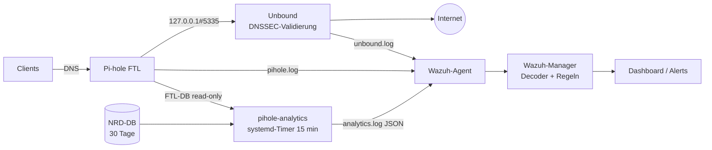

# DNS Detection Engineering mit Wazuh, Pi-hole und Unbound

Drei Sensoren, eine Kette: **Pi-hole** sieht, *wer was fragt*. **Unbound** sieht, *ob die Antwort vertrauenswürdig ist*. **pihole-analytics** sieht *Muster über Zeit*, die keine Einzelzeile verrät. Alles landet als strukturierte Events in Wazuh und wird dort über eigene Decoder und Regeln bewertet.

Homelab-Projekt, produktiv im Heimnetz. Jede Regel ist mit echtem Traffic getestet, jedes Finding triagiert, jedes Tuning begründet – siehe [`TUNING.md`](TUNING.md).

## Architektur



## Module

| Modul | Datenquelle | Decoder | Rule-IDs | Erkennt |
|---|---|---|---|---|
| Pi-hole Query-Log | `/var/log/pihole/pihole.log` | `0100-pihole_decoders.xml` | 110000–110060 | Blocks und Blocklist-Beaconing, TXT-Tunneling, NXDOMAIN-Sturm, DoH-Bypass, Heuristiken (überlange Labels, DGA-Muster, Missbrauchs-TLDs) |
| Unbound | `/var/log/unbound/unbound.log` | `0101-unbound_decoders.xml` | 110070–110077 | DNSSEC-Validierungsfehler, SERVFAIL-Häufung, übergroße Antworten, langsame Auflösung, Resolver-Fehler und -Neustarts |
| Hardware (Proxmox-Host) | `/var/log/hw-metrics/hw-metrics.log` | JSON | 110100–110111 | CPU-/NVMe-Temperatur, NVMe-SMART (Media-Errors, Reserve, Verschleiß, Selbsttest), volles Root-Dateisystem |
| Docker (IRIS-Host) | Docker-Socket via Agent-Wodle | JSON | 110120 | Container-Start mit einem Image, das nicht zum ausgerollten Stack gehört |
| Honeypot (OpenCanary) | `/var/log/opencanary/opencanary.log` | JSON | 110130–110135 | Berührung, Login-Versuch, Brute-Force, Portscan – auf einem Köder ist jeder Treffer echt |
| FRITZ!Box | Ereignisprotokoll + TR-064 via `fritz-monitor.py` | JSON | 110140–110155 | Router-Logins und Brute-Force, Einstellungsänderungen, Port-Freigaben, neue Geräte, WLAN-Fehlanmeldungen, WAN/VPN/System |
| Suricata | Mirror-Port, `eve-wazuh.json` (nur Alerts) | JSON | 110160–110168 | ET-Open-Signaturen nach Severity, eigene: DoH/DoT/DNS-Bypass per SNI und Port, SNMP-Discovery |
| Kismet (WLAN) | REST-API via `kismet-wazuh.py` | JSON | 110170–110178 | Evil Twin, Deauth-Angriffe, unbekannte Clients am eigenen AP, Probes nach eigener SSID, neue Nachbarn |
| pihole-analytics | FTL-Datenbank + NRD-Liste | JSON | 110080, 110090–110099 | Korrelation NRD + DGA/Beaconing/Tunneling pro Client, Tunneling (viele verschiedene lange Subdomains), Beaconing (auch auf geblockte Domains), DGA, NXDOMAIN-Sturm pro Client, Newly Registered Domains, Heartbeat und Selbstüberwachung |

Vollständige Regelliste mit Leveln, Eltern und MITRE-Mapping: [`docs/RULES.md`](docs/RULES.md) (generiert).

Zwei Entwurfsentscheidungen, die den Unterschied machen:

- **Gate-Regeln statt Ausnahmen pro Regel.** Alle Detections hängen an zwei Level-0-Zwischenregeln: 110002 lässt nur externe, nicht allowgelistete Domains durch, 110003 lässt zusätzlich nur `query`-Zeilen ohne bekannte CDN-/Vendor-Suffixe zu den Heuristiken. Ausnahmen werden so an genau einer Stelle gepflegt. Wichtig dabei: Wazuh wertet Level-0-Kindregeln zuerst aus und steigt danach nur noch in deren Kinder ab. Regeln, die auf beiden Pfaden gelten sollen (Blocked, TXT, NXDOMAIN, DoH), hängen deshalb an beiden Gates (`if_sid 110002, 110003`). Genau diesen Fehler haben die Regressionstests aufgedeckt.
- **Statistik außerhalb des SIEM.** Beaconing (Median/MAD der Intervalle), DGA-Scoring auf eTLD+1 und NRD-Abgleich gegen 11 Mio. Domains passen nicht in Regel-Syntax. Das erledigt ein gehärtetes Python-Skript auf dem Pi, Wazuh bekommt nur das Ergebnis.
- **Generische Logik und lokales Tuning sind getrennt.** Das Regelwerk im Repo enthält nur allgemeingültige Ausnahmen (große CDNs). Umgebungsspezifische Suffixe stehen in `rules/0109-local_overrides.xml`, die Gate 110003 per `overwrite="yes"` ersetzt und nicht versioniert wird; Vorlagen liegen als `.example` bei. Dasselbe gilt für die beiden Allowlists (`lists/dns-allow`, `analytics/config/allowlist.txt`): echte Dateien lokal, Vorlagen im Repo. So bleibt das Repo für andere nutzbar und verrät nichts über das eigene Netz.

## Repo-Struktur

```
decoders/        Wazuh-Decoder            -> /var/ossec/etc/decoders/
rules/           Wazuh-Regeln             -> /var/ossec/etc/rules/
lists/           CDB-Allowlist dns-allow  -> /var/ossec/etc/lists/
agent/           agent.conf der Gruppe    -> /var/ossec/etc/shared/<gruppe>/
unbound/         Logging-Konfiguration und Logrotate für Unbound
analytics/       pihole-analytics: Skript, Config, systemd-Units, Logrotate
tests/           Testfälle und Runner für wazuh-logtest
scripts/         collect / deploy / check-public / gen-rule-table
infra/           Mail-Relay, hw-metrics, honeypot, fritzbox, misp, sensor (Suricata) (Sensor-Skript + systemd-Timer fuer den Proxmox-Host) (Postfix-LXC) fuer Benachrichtigungen
integrations/    Wazuh Custom Integration -> DFIR-IRIS
dashboards/      Wazuh-Dashboard als Saved-Objects-Import (.ndjson)
docs/            DOKUMENTATION.md (ausführlich), RULES.md (generiert)
TUNING.md        Triage-Protokoll: Finding -> Bewertung -> Maßnahme
```

## Installation

Voraussetzungen: Wazuh 4.x, Pi-hole 6.x mit `dns.queryLogging = true` und `misc.privacylevel = 0`, Unbound mit `log-replies`, `log-servfail` und `val-log-level: 2`.

```bash
# auf dem Wazuh-Manager, als root
git clone <repo-url> && cd wazuh-dns-detection
./scripts/deploy-manager.sh --with-lists   # Konfigtest + Rollback eingebaut
./tests/run-logtest.sh
```

In der `ossec.conf` des Managers muss die Liste im `<ruleset>`-Block stehen: `<list>etc/lists/dns-allow</list>`. Die `agent/agent.conf` gehört in die Agent-Gruppe des Pi-hole; der Sync zum Agent dauert bis zu zehn Minuten. Einrichtung von pihole-analytics: siehe `docs/DOKUMENTATION.md`.

## Tests

Ein Fall ist eine Datei in `tests/cases/` mit echten Logzeilen und der Menge an Rule-IDs, die feuern muss. Jeder Fall läuft in einer eigenen `wazuh-logtest`-Session, damit Frequency-Regeln sauber zählen.

```bash
./tests/run-logtest.sh                   # alles prüfen, Exit-Code 1 bei Abweichung
./tests/run-logtest.sh --record <fall>   # Ist-Zustand als Soll festhalten
./tests/run-logtest.sh --table           # tests/expected.md erzeugen
```

Negativtests gehören dazu: interne Namen und CDN-Hosts dürfen die Gates nicht passieren.

## Dashboard

`dashboards/dns-detection-dashboard.ndjson` enthält ein fertiges Dashboard (Kennzahlen, Verlauf nach Regel, Module, Top-Regeln/-Domains/-Clients, Analytics-Findings, MITRE, Detailliste ab Level 7). Import im Wazuh-Dashboard unter *Dashboards Management → Saved objects → Import*; fehlen danach Felder wie `data.dns.domain`, einmal die Feldliste des Index-Patterns `wazuh-alerts-*` aktualisieren.

## Tuning und Betrieb

Erstlauf von pihole-analytics: 20.931 Queries, 5 Findings, alle triagiert, 0 True Positives. Jede daraus abgeleitete Allowlist- oder Schwellwert-Änderung steht mit Begründung in [`TUNING.md`](TUNING.md). Die bekannten Stolperfallen (OSRegex ohne Alternation, CDB nur exakt, Level-Reihenfolge bei Kindregeln …) stehen in `docs/DOKUMENTATION.md`, Abschnitt 8.

## Case Management

Alerts der Regeln 110026, 110080 und 110099 (Level ≥ 10) landen per Wazuh Custom Integration als Alert in DFIR-IRIS, mit IOCs und vollem Kontext; siehe [`integrations/`](integrations/README.md).

## Benachrichtigungen

Alerts ab Level 10 gehen zusätzlich per Mail raus (Wazuh `email_alert_level` 10) – über einen eigenen Postfix-Relay mit eigener Domain, DKIM-signiert; siehe [`infra/`](infra/README.md).

## Roadmap

- SOAR-Anreicherung: Shuffle zwischen Wazuh und IRIS (WHOIS, Threat Intel, Gerätename zur Client-IP); LLM-Triage als späterer Schritt im selben Workflow
- ~~Suricata~~ (erledigt: `infra/sensor/`), Velociraptor + Atomic Red Team, LLM-gestützte Triage

## Lizenz

[MIT](LICENSE). Die NRD-Daten stammen von [smet.cz](https://smet.cz/nrd/) (CC BY 4.0); sie werden zur Laufzeit geladen und sind nicht Teil dieses Repos.
